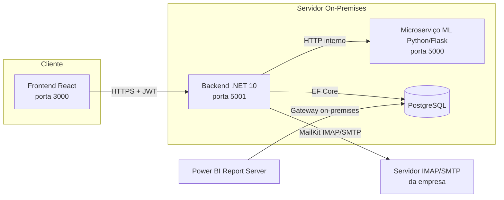
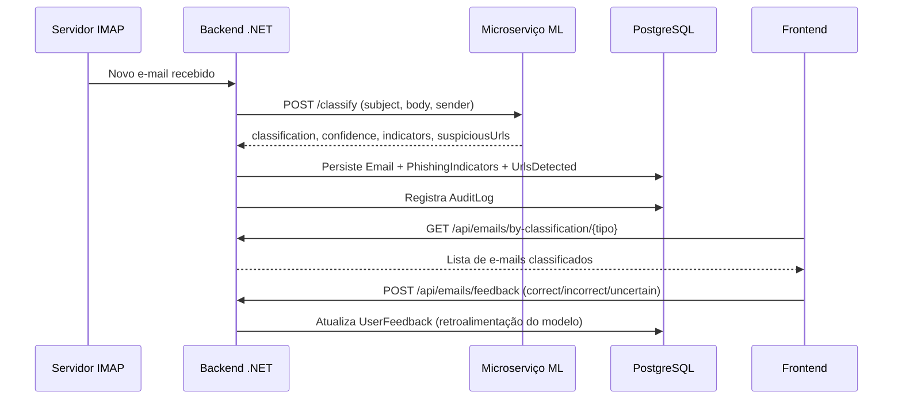

# Arquitetura do Sistema - Detecção de Phishing

**Data:** 30 de Agosto de 2026
**Versão:** 1.0
**Projeto:** TCC Impacta — Health2B Hospitalar Ltda.

---

## 1. Visão Geral

O sistema é composto por três serviços independentes (backend, microserviço de ML e
frontend), um banco de dados relacional compartilhado e uma camada de relatórios
(Power BI). Toda a solução roda **on-premises**, sem dependência de nuvem pública,
conforme requisito de segurança/LGPD do Health2B Hospitalar Ltda.

## 2. Componentes

### 2.1 Backend (`backend/PhishingDetectionAPI`)

- **Stack:** C# / .NET 10, ASP.NET Core Web API.
- **Responsabilidades:** autenticação/autorização (JWT), regras de negócio, persistência
  (Entity Framework Core + PostgreSQL), orquestração da classificação (chama o
  microserviço de ML via Refit), auditoria (LGPD), integração de e-mail (MailKit).
- **Arquitetura interna:** em camadas — `Domain` (entidades e interfaces), `Application`
  (serviços e DTOs), `Infrastructure` (EF Core, repositórios, segurança JWT, cliente
  HTTP do ML), `Presentation` (controllers REST).
- **Princípios aplicados:** SOLID (ver [backend/README.md](../backend/README.md#princípios-solid-aplicados)),
  Repository Pattern, Dependency Injection.

### 2.2 Microserviço de Machine Learning (`ml/`)

- **Stack:** Python 3.9+, scikit-learn, Flask.
- **Responsabilidades:** pré-processamento de texto, extração de features heurísticas,
  treinamento e inferência do ensemble Naive Bayes + Random Forest.
- **Exposição:** API HTTP simples (`/health`, `/classify`, `/classify-batch`,
  `/reload-models`), consumida exclusivamente pelo backend — nunca diretamente pelo
  frontend. Detalhes em [ml/README.md](../ml/README.md).

### 2.3 Frontend (`frontend/`)

- **Stack:** React 18, React Router, Axios.
- **Responsabilidades:** login, dashboard de classificações, listagem de e-mails com
  feedback do usuário, formulário de classificação manual (teste).
- **Autenticação:** token JWT armazenado no `localStorage`, injetado em toda requisição
  via interceptor Axios. Detalhes em [frontend/README.md](../frontend/README.md).

### 2.4 Banco de Dados (`database/`)

- **SGBD:** PostgreSQL 13+.
- **Estrutura:** 13 tabelas (e-mails, indicadores, URLs, anexos, usuários, auditoria,
  consentimento LGPD, solicitações de exclusão, configurações, notificações,
  desempenho do modelo, estatísticas diárias) + 3 views de relatório.
- **Scripts:** `schema.sql` (DDL), `seed.sql` (dados iniciais), `migrations/`
  (scripts incrementais versionados). Ver [database/schema.sql](../database/schema.sql).

### 2.5 Relatórios (`powerbi/`)

- **Ferramenta:** Power BI Desktop + Power BI Report Server (on-premises).
- **Fonte de dados:** conexão direta ao PostgreSQL (import), atualizada via
  On-premises Data Gateway. Ver [powerbi/README.md](../powerbi/README.md).

## 3. Fluxo de Classificação de um E-mail

## 4. Segurança

| Camada | Controle |
|--------|----------|
| Transporte | HTTPS obrigatório em produção (`app.UseHttpsRedirection()`) |
| Autenticação | JWT (HMAC-SHA256), expiração configurável |
| Autorização | RBAC — papéis `User`, `Analyst`, `Admin` |
| Dados sensíveis | Senhas com hash (nunca texto plano); `password_hash` nunca exposto em DTOs ou Power BI |
| Auditoria | Toda ação relevante registrada em `AuditLog` (LGPD) |
| Retenção de dados | Configurável via `system_config` (`DATA_RETENTION_DAYS`, `ANONYMIZE_AFTER_DAYS`) |
| Rede | Todos os serviços atrás do firewall interno; ML e backend não expostos diretamente à internet |
| OWASP Top 10 | Validação de entrada (FluentValidation), proteção contra SQL Injection (EF Core parametrizado), CORS restrito em produção |

## 5. Escalabilidade e Disponibilidade

- **Meta de performance:** classificação em menos de 2 segundos por e-mail.
- **Meta de volume:** suportar 10.000+ e-mails/dia.
- **Meta de disponibilidade:** 99,5% de uptime.
- **Estratégia:** backend e ML como processos independentes (podem escalar
  horizontalmente atrás de um load balancer interno); banco de dados com índices
  dedicados para as consultas mais frequentes (ver `database/migrations/006_create_performance_indexes.sql`).

## 6. Referências Cruzadas

- Plano de desenvolvimento completo: [PLANO_DESENVOLVIMENTO.md](../PLANO_DESENVOLVIMENTO.md)
- Especificação da API: [docs/API_SPEC.md](API_SPEC.md)
- Guia de deployment: [docs/DEPLOYMENT_GUIDE.md](DEPLOYMENT_GUIDE.md)
- Guia do usuário: [docs/USUARIO_GUIDE.md](USUARIO_GUIDE.md)
